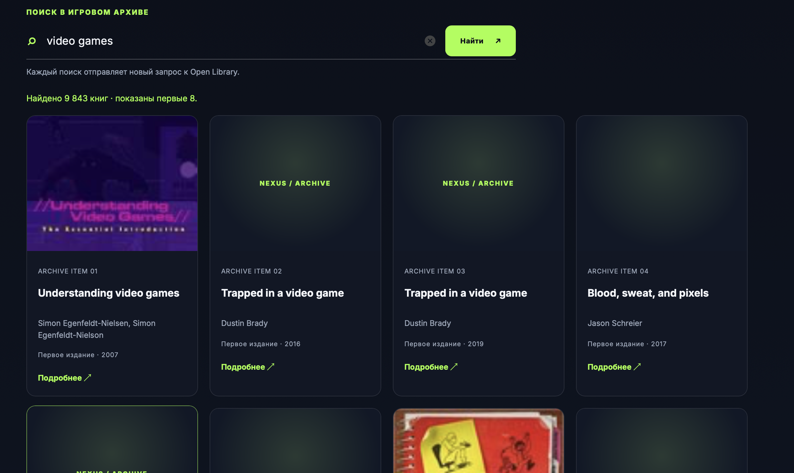

# NEXUS — компьютерный клуб

Лендинг компьютерного клуба NEXUS в Алматы и интерактивная игровая библиотека. Проект продолжает лабораторные работы по HTML, CSS и JavaScript: бронирование, тарифы и преимущества клуба дополнены клиентом публичного REST API.

## Лабораторная работа 6 — Async, Promise, Fetch, REST

- Данные загружаются через `fetch` и `async/await` и отображаются карточками.
- Поле поиска отправляет новый запрос в Open Library с параметром `q`.
- Кнопка «Подробнее» запрашивает описание конкретного произведения по ключу `/works/{id}.json`.
- Две подборки книг загружаются параллельно с помощью `Promise.all`.
- Во время ожидания показываются состояния загрузки; сетевые ошибки, HTTP-ошибки и пустые результаты отображаются на странице.

### API

- Open Library Search API: `https://openlibrary.org/search.json`
- Open Library Works API: `https://openlibrary.org/works/{work_id}.json`
- Open Library Covers: `https://covers.openlibrary.org/b/id/{cover_id}-M.jpg`
- Base URL: `https://openlibrary.org`

`await` приостанавливает выполнение текущей `async`-функции, пока Promise запроса не завершится, и возвращает результат, поэтому код удобно читать по шагам. Пока запрос выполняется, интерфейс показывает состояние загрузки. `fetch` может получить HTTP-ответ с ошибочным статусом, например 404, не отклонив Promise. Поэтому код проверяет `response.ok` и сам создаёт ошибку для неуспешного HTTP-ответа; `try/catch` показывает понятное сообщение при сетевых и HTTP-ошибках.

### Запуск

Откройте `index.html` в браузере с доступом к интернету или запустите папку через Live Server. Проект использует чистые HTML, CSS и JavaScript без фреймворков и библиотек для запросов.

### Скриншот

### Предыдущие лабораторные

- Семантические `header`, `nav`, `main`, `section`, `article`, `footer`.
- Адаптивная вёрстка, SEO-метаданные, подписи форм и видимый focus.
- Чистый современный CSS с переменными, Grid/Flexbox и `clamp()`.

### ИИ-инструменты

Использованы ChatGPT и OpenAI Codex для разбора требований, планирования и подготовки доработки. Автору следует просмотреть код и быть готовым объяснить работу `fetch`, `async/await`, `response.ok`, `try/catch` и `Promise.all` на защите.

## GitHub Pages

https://zhandos959.github.io/landing-tolemisov/
